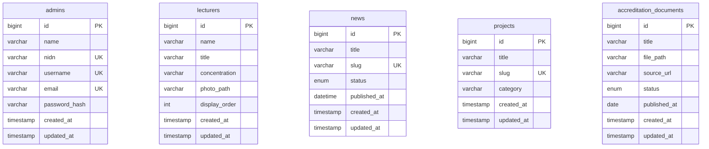

# 04-database.md — Database Source of Truth

Project: Website Program Studi Teknologi Rekayasa Multimedia (TRM), Politeknik Dewantara

Status dokumen: DATABASE SOURCE OF TRUTH. Keputusan MVP ditetapkan di dokumen ini; keputusan untuk fase yang ditunda tetap diberi label TBD.

Catatan konteks: schema lima tabel MVP sudah dibuat dan digunakan. Schema RAG, T37.1 ingestion, dan T37.2 embedding tersedia; retrieval dan chatbot masih tahap berikutnya.

---

## 1. Tujuan Database

Database menyimpan data dinamis Website Prodi TRM. Kebutuhan yang didukung:

1. Profil prodi, hanya jika perlu dinamis (keputusan di bagian 21).
2. Data dosen/struktur.
3. Berita.
4. Project/karya mahasiswa.
5. Pengumuman, hanya jika masuk scope (keputusan di bagian 19).
6. Data akreditasi/dokumen.
7. Admin/authentication.
8. Metadata pendukung chatbot/RAG pada tahap akhir.
9. Metadata waktu pembuatan dan perubahan data.

Prinsip: SIMPLE, CLEAR, MAINTAINABLE, SECURE, SCALABLE ENOUGH, NOT OVER-ENGINEERED. Database ini bukan sistem akademik kampus.

## 2. Stack Database

- Database: MySQL 8.4 LTS.
- Backend: Node.js, Express.js, `mysql2/promise`.
- Akses database lewat connection pool, dengan `async/await`. Tidak memakai API berbasis callback.

## 3. Prinsip Database

1. Struktur tabel jelas.
2. Nama tabel konsisten.
3. Nama kolom konsisten.
4. Primary key jelas.
5. Foreign key hanya jika benar-benar diperlukan.
6. Index hanya pada kolom yang sering dicari/difilter.
7. Hindari duplikasi data yang tidak perlu.
8. Tidak membuat tabel agar terlihat kompleks.
9. Tidak membuat relasi yang tidak dibutuhkan fitur.
10. Mudah dipahami developer pemula.

## 4. Primary Key

Semua tabel memakai:

```
id BIGINT UNSIGNED AUTO_INCREMENT PRIMARY KEY
```

UUID tidak dipakai karena belum ada kebutuhan nyata.

## 5. Timestamp Standard

ATURAN PENTING. Setiap tabel yang dikelola lewat CRUD admin wajib punya:

```
created_at TIMESTAMP NOT NULL DEFAULT CURRENT_TIMESTAMP
updated_at TIMESTAMP NOT NULL DEFAULT CURRENT_TIMESTAMP ON UPDATE CURRENT_TIMESTAMP
```

Tujuan: admin dapat mengetahui kapan data dibuat dan kapan terakhir diubah. Nilainya diisi oleh database, bukan diinput manual oleh admin.

## 6. created_at dan updated_at

Berlaku untuk semua entity utama yang dikelola admin:

| Tabel                       | created_at | updated_at |
| --------------------------- | ---------- | ---------- |
| admins                      | ya         | ya         |
| lecturers                   | ya         | ya         |
| news                        | ya         | ya         |
| projects                    | ya         | ya         |
| accreditation_documents     | ya         | ya         |
| rag_documents                | ya        | ya         |
| rag_chunks                   | tidak     | tidak      |

Tabel `announcements` tidak dibuat pada versi awal sesuai keputusan user (bagian 19).

Tabel sistem tertentu boleh memiliki struktur berbeda jika ada alasan teknis. Saat ini belum ada tabel sistem seperti itu.

## 7. Jangan Over-Engineering Timestamp

Tidak ditambahkan secara otomatis: `created_by`, `updated_by`, `deleted_at`, `published_at`, `approved_at`, `archived_at`, `reviewed_at`.

Timestamp domain tambahan hanya dipakai pada `news.published_at` untuk publikasi berita dan `accreditation_documents.published_at` untuk tanggal terbit dokumen. Kolom lain tidak mendapat timestamp tambahan tanpa kebutuhan fitur.

## 8. Soft Delete

Keputusan: **tidak memakai soft delete**. Tidak ada kolom `deleted_at`. Semua CRUD memakai `DELETE` biasa. Alasan: belum ada kebutuhan bisnis yang menuntut data terhapus bisa dipulihkan, dan soft delete menambah kompleksitas query (`WHERE deleted_at IS NULL` di mana-mana). Pengaman yang dipakai adalah konfirmasi delete (bagian 41) dan backup (bagian 51).

## 9. Audit Log

Keputusan: **tidak ada** `audit_logs`, `activity_logs`, `change_history`, atau `version_history`. Kebutuhan saat ini cukup dipenuhi `created_at` dan `updated_at`. Jika audit trail dibutuhkan kelak, ditambahkan sebagai fitur terpisah dengan persetujuan user.

## 10. Entitas Utama

Hasil evaluasi (detail alasan di bagian 57):

| Kandidat                | Keputusan                                              |
| ----------------------- | ------------------------------------------------------ |
| admins                  | DIBUAT                                                 |
| lecturers               | DIBUAT                                                 |
| news                    | DIBUAT                                                 |
| projects                | DIBUAT                                                 |
| accreditation_documents | DIBUAT (daftar PDF/sumber resmi yang dikelola admin) |
| announcements           | TIDAK DIBUAT (user menetapkan berita mencukupi, bagian 19) |
| program_profile         | TIDAK DIBUAT (profil statis sesuai keputusan user, bagian 21) |
| rag_documents           | DIBUAT melalui migration RAG (bagian 47)               |
| rag_chunks              | DIBUAT melalui migration RAG (bagian 47)               |

Schema MVP yang sudah dibuat: `admins`, `lecturers`, `news`, `projects`, `accreditation_documents`. `rag_documents` dan `rag_chunks` ditambahkan melalui migration terpisah.

## 11. Admin / Users

### admins

Purpose: akun admin untuk login ke dashboard (pengelola utama: kaprodi).

Columns:

| Column        | Type            | Null | Key    | Default                     | Description                                                   |
| ------------- | --------------- | ---- | ------ | --------------------------- | ------------------------------------------------------------- |
| id            | BIGINT UNSIGNED | NO   | PK     | AUTO_INCREMENT              | ID admin                                                      |
| name          | VARCHAR(100)    | NO   |        |                             | Nama admin                                                    |
| email         | VARCHAR(150)    | YES  | UNIQUE | NULL                        | Email kontak opsional; bukan identitas login                 |
| nidn          | VARCHAR(20)     | NO   | UNIQUE |                             | Identitas login dosen                                        |
| username      | VARCHAR(50)     | NO   | UNIQUE |                             | Identitas login yang dapat diubah admin                      |
| password_hash | VARCHAR(255)    | NO   |        |                             | Hash password (bukan plaintext)                               |
| created_at    | TIMESTAMP       | NO   |        | CURRENT_TIMESTAMP           | Waktu dibuat                                                  |
| updated_at    | TIMESTAMP       | NO   |        | CURRENT_TIMESTAMP ON UPDATE | Waktu terakhir diubah                                         |

Indexes: UNIQUE `nidn`, `username`, dan `email` (MySQL mengizinkan beberapa nilai NULL pada unique index).

Relationships: tidak ada foreign key pada versi awal.

CRUD: tidak ada UI CRUD akun admin; admin dapat mengubah NIDN dan username sendiri pada pengaturan. Penggantian password tidak masuk pengaturan MVP dan dikelola melalui prosedur admin yang terkontrol.

Notes:

- Login menerima NIDN dosen atau username. Backend memangkas whitespace dan menormalisasi username ke huruf kecil.
- NIDN dan username unik; perubahan keduanya memeriksa keunikan sebelum disimpan. Email tidak dipakai untuk autentikasi.
- NIDN dan username dapat diubah sendiri admin melalui pengaturan; keduanya tetap menjadi identitas login yang unik.
- Password di-hash dengan bcryptjs, asynchronous, work factor 12. Panjang input dibatasi agar tidak melewati batas bcrypt 72 byte.
- Session memakai signed HTTP-only cookie berisi ID admin dan metadata expiry, berlaku 8 jam, tanpa refresh token dan tanpa tabel session. Cookie `SameSite=Lax`; `Secure` di production. Logout menghapus cookie; rotasi `SESSION_SECRET` membatalkan seluruh session.

## 12. Role Admin

Tidak ada sistem role dan kolom `role` pada MVP. Semua akun pada tabel `admins` adalah admin; tidak dibuat RBAC, tabel `roles`, tabel `permissions`, ataupun tabel session. Jika kelak muncul peran berbeda, schema diubah secara terpisah dengan persetujuan user (bagian 62).

## 13. Lecturers

### lecturers

Purpose: data dosen untuk halaman structure/profile (organization chart: Kaprodi dan dosen konsentrasi Web Design, Desain Grafis, Videografi).

Columns:

| Column        | Type            | Null | Key   | Default                     | Description                                              |
| ------------- | --------------- | ---- | ----- | --------------------------- | -------------------------------------------------------- |
| id            | BIGINT UNSIGNED | NO   | PK    | AUTO_INCREMENT              | ID dosen                                                 |
| name          | VARCHAR(150)    | NO   |       |                             | Nama (termasuk gelar)                                    |
| title         | VARCHAR(150)    | NO   |       |                             | Role/jabatan, mis. Kaprodi, Dosen Konsentrasi Web Design |
| concentration | VARCHAR(50)     | YES  |       | NULL                        | Konsentrasi; NULL untuk Kaprodi                          |
| photo_path    | VARCHAR(255)    | YES  |       | NULL                        | Path foto resmi; NULL jika belum ada (placeholder di UI) |
| bio           | TEXT            | YES  |       | NULL                        | Bio singkat jika dipakai di preview profil               |
| email         | VARCHAR(150)    | YES  |       | NULL                        | Kontak dosen; tidak dikirim pada response public         |
| display_order | INT UNSIGNED    | NO   | INDEX | 0                           | Urutan tampil yang diatur admin                          |
| created_at    | TIMESTAMP       | NO   |       | CURRENT_TIMESTAMP           | Waktu dibuat                                             |
| updated_at    | TIMESTAMP       | NO   |       | CURRENT_TIMESTAMP ON UPDATE | Waktu terakhir diubah                                    |

Indexes: `display_order` (untuk pengurutan).

Relationships: tidak ada.

CRUD: dikelola admin (create, read, update, delete). Public hanya membaca.

Notes:

- `concentration` memakai VARCHAR, bukan ENUM. Nilai kanonis yang disetujui: `Web Design`, `Desain Grafis`, dan `Videografi`; gunakan tepat sama di database, API, dan frontend. `NULL` untuk Kaprodi.
- Foto dosen harus foto resmi; tidak boleh generated. Jika belum ada, kolom NULL dan UI menampilkan placeholder.
- Hierarki chart tetap ditentukan oleh UI; kolom `parent_id` tidak dibuat.
- Lebih dari satu dosen boleh berada di konsentrasi yang sama. Setiap dosen adalah satu row; satu Kaprodi aktif ditampilkan sesuai `title` dan urutan. Tidak ada constraint unik pada `concentration` atau `title`.
- Email tidak ditampilkan di public API pada MVP. Kolom tetap opsional untuk pengelolaan admin dan hanya dapat ditampilkan kelak setelah disetujui.

## 14. Structure Order

Urutan dosen dikontrol lewat `lecturers.display_order`. Admin mengubah urutan dengan input angka sederhana, tanpa drag-and-drop. Jika nilai urutan sama, backend mengurutkan lanjut berdasarkan `id ASC`.

## 15. News

### news

Purpose: berita/publikasi program studi.

Columns:

| Column         | Type                      | Null | Key    | Default                     | Description                                       |
| -------------- | ------------------------- | ---- | ------ | --------------------------- | ------------------------------------------------- |
| id             | BIGINT UNSIGNED           | NO   | PK     | AUTO_INCREMENT              | ID berita                                         |
| title          | VARCHAR(200)              | NO   |        |                             | Judul                                             |
| slug           | VARCHAR(220)              | NO   | UNIQUE |                             | Slug URL                                          |
| excerpt        | VARCHAR(500)              | YES  |        | NULL                        | Ringkasan                                         |
| content        | MEDIUMTEXT                | NO   |        |                             | Isi berita                                        |
| thumbnail_path | VARCHAR(255)              | YES  |        | NULL                        | Path gambar                                       |
| status         | ENUM('draft','published') | NO   |        | 'draft'                     | Status publikasi                                  |
| published_at   | DATETIME                  | YES  |        | NULL                        | Waktu tayang, diisi saat status menjadi published |
| created_at     | TIMESTAMP                 | NO   |        | CURRENT_TIMESTAMP           | Waktu dibuat                                      |
| updated_at     | TIMESTAMP                 | NO   |        | CURRENT_TIMESTAMP ON UPDATE | Waktu terakhir diubah                             |

Indexes: UNIQUE `slug`; INDEX `(status, published_at)` untuk daftar berita publik. Tidak membuat index tunggal tambahan pada `status`/`published_at`; composite index sudah memiliki prefix `status`.

Relationships: tidak ada (tanpa `admin_id`, karena penulis tidak ditampilkan; lihat bagian 22).

CRUD: dikelola admin. Public membaca hanya `status = 'published'`.

Notes:

- Tidak ada workflow editorial kompleks; hanya draft dan published.
- `content` disimpan sebagai plain text dengan line break; admin memakai textarea sederhana. HTML tidak disimpan atau dirender.
- Kategori berita tidak dipakai dan tidak memiliki kolom.

## 16. News Slug

- Dipakai API untuk detail berita berdasarkan slug; halaman frontend final adalah `/berita/{slug}`.
- Harus unik, URL-friendly, dan mudah dicari. Unique index pada `news.slug`.
- Slug dibuat backend saat record dibuat. Bentrok diselesaikan dengan suffix angka (`-2`, `-3`, ...), dan unique constraint tetap menjadi pengaman akhir.
- Perubahan judul tidak mengubah slug secara otomatis; slug yang sudah diterbitkan dipertahankan agar URL tidak putus. Tidak ada slug history atau redirect.

## 17. Projects

### projects

Purpose: showcase karya mahasiswa.

Columns:

| Column         | Type                      | Null | Key    | Default                     | Description                                                              |
| -------------- | ------------------------- | ---- | ------ | --------------------------- | ------------------------------------------------------------------------ |
| id             | BIGINT UNSIGNED           | NO   | PK     | AUTO_INCREMENT              | ID project                                                               |
| title          | VARCHAR(200)              | NO   |        |                             | Judul karya                                                              |
| slug           | VARCHAR(220)              | NO   | UNIQUE |                             | Slug URL                                                                 |
| description    | TEXT                      | YES  |        | NULL                        | Deskripsi karya                                                          |
| thumbnail_path | VARCHAR(255)              | NO   |        |                             | Path gambar utama wajib untuk showcase image-first                       |
| category       | VARCHAR(50)               | NO   | INDEX  |                             | Allowlist: desain, coding, 3d, multimedia, lainnya                 |
| student_name   | VARCHAR(150)              | YES  |        | NULL                        | Nama mahasiswa pembuat                                                   |
| project_year   | SMALLINT UNSIGNED         | YES  |        | NULL                        | Tahun karya (bukan nama kolom `year`, agar tidak bentrok dengan keyword) |
| external_url   | VARCHAR(500)              | YES  |        | NULL                        | Link eksternal karya                                                     |
| created_at     | TIMESTAMP                 | NO   |        | CURRENT_TIMESTAMP           | Waktu dibuat                                                             |
| updated_at     | TIMESTAMP                 | NO   |        | CURRENT_TIMESTAMP ON UPDATE | Waktu terakhir diubah                                                    |

Indexes: UNIQUE `slug`; INDEX `category`; INDEX `(created_at, id)` untuk urutan daftar public.

Relationships: tidak ada.

CRUD: dikelola admin. Public membaca seluruh project karena semua karya langsung tayang.

Notes:

- Tidak ada tabel `project_categories`, `project_tags`, dan sejenisnya. Cukup satu kolom `category`.
- Nilai kategori baku: `desain`, `coding`, `3d`, `multimedia`, `lainnya` (huruf kecil). Backend menolak nilai di luar daftar tersebut.
- Satu project memakai satu gambar utama `thumbnail_path`; galeri multi-gambar tidak masuk MVP.
- Project yang dibuat admin langsung tampil public setelah tersimpan; tidak ada status draft/published.

## 18. Project Publishing

Keputusan user: project langsung tayang. Kolom `status` tidak dibuat. Public API membaca seluruh project; pengurutan memakai `created_at DESC, id DESC`.

## 19. Announcements

Keputusan: **tabel `announcements` tidak dibuat** pada versi awal.

Alasan: fitur yang diketahui untuk project ini tidak mencantumkan pengumuman sebagai entity terpisah; berita sudah dapat dipakai untuk informasi publik. Membuat tabel tanpa fitur melanggar bagian 57.

Keputusan user: informasi pengumuman disampaikan melalui berita. Tidak ada tabel pengumuman pada MVP.

## 20. Accreditation Documents

### accreditation_documents

Purpose: dokumen/sumber resmi akreditasi yang ditampilkan di halaman accreditation dan dapat didownload/dicetak.

Columns:

| Column       | Type            | Null | Key | Default                     | Description                              |
| ------------ | --------------- | ---- | --- | --------------------------- | ---------------------------------------- |
| id           | BIGINT UNSIGNED | NO   | PK  | AUTO_INCREMENT              | ID dokumen                               |
| title        | VARCHAR(200)    | NO   |     |                             | Judul dokumen                            |
| description  | TEXT            | YES  |     | NULL                        | Keterangan                               |
| file_path    | VARCHAR(255)    | NO   |     |                             | Path PDF resmi di storage                |
| source_url   | VARCHAR(500)    | YES  |     | NULL                        | Link sumber resmi                        |
| status       | ENUM('draft','published') | NO | INDEX | 'draft' | Status publikasi dokumen                 |
| published_at | DATE            | YES  |     | NULL                        | Tanggal terbit dokumen (bila diperlukan) |
| created_at   | TIMESTAMP       | NO   |     | CURRENT_TIMESTAMP           | Waktu dibuat                             |
| updated_at   | TIMESTAMP       | NO   |     | CURRENT_TIMESTAMP ON UPDATE | Waktu terakhir diubah                    |

Indexes: INDEX `status` untuk mengambil dokumen berstatus published.

Relationships: tidak ada.

CRUD: dokumen dikelola admin (tambah, baca, ubah metadata/status, hapus). Public hanya membaca dokumen `status = 'published'`. Satu atau lebih PDF dapat disimpan.

Notes:

- Dokumen yang ditampilkan untuk surat keterangan adalah PDF resmi yang disediakan program studi; website tidak merakit atau mengubah isi surat.
- `file_path` wajib. `source_url` opsional sebagai tautan ke sumber resmi terkait.
- Tidak ada field terstruktur peringkat, nomor SK, atau masa berlaku karena informasi tersebut sudah berada dalam PDF resmi.
- Keputusan MVP: tabel ini dipertahankan agar admin dapat mengelola daftar dokumen tanpa perubahan source code.
- **DECIDED (2026-10-03):** status publikasi memakai `draft` dan `published`; endpoint publik mengembalikan hanya `published`. Status ini bukan approval workflow terpisah.
- Storage belum ditentukan. Simpan path dan metadata saja pada tahap database/API; upload dan provider storage ditunda.

## 21. Program Profile

Keputusan: **tidak ada tabel profile** pada versi awal. Konten profil (deskripsi, visi, misi) diperlakukan sebagai konten statis.

Keputusan user: profil prodi statis, tidak ada tabel profile pada MVP. Isi data seperti visi/misi tidak diisi di dokumen ini.

## 22. Relationship

Pada versi awal **tidak ada foreign key**. Semua tabel berdiri sendiri.

Contoh yang sengaja tidak dibuat: `news.admin_id → admins.id`, karena penulis berita tidak ditampilkan di frontend/admin menurut kebutuhan yang diketahui. Jika kebutuhan "penulis/pembuat" muncul, relasi ditambahkan lewat schema change.

Setiap relationship yang ditambahkan kelak wajib didokumentasikan di sini.

## 23. Normalization

Normalization secukupnya. Tidak ada tabel kecil yang dipecah tanpa alasan. Contoh yang sengaja tidak dibuat: `project_categories`, `project_category_translations`, `project_metadata`, `project_tags`, `project_tag_relations`.

## 24. Index

Index hanya untuk search, filter, sorting, unique constraint, dan lookup:

| Tabel     | Index                                             | Alasan                                     |
| --------- | ------------------------------------------------- | ------------------------------------------ |
| admins    | UNIQUE `nidn`, `username`, `email`                | Identitas login dan keunikan               |
| lecturers | `display_order`                                   | Pengurutan structure                       |
| news      | UNIQUE `slug`; `(status, published_at)`           | Detail URL; daftar publik                  |
| projects  | UNIQUE `slug`; `category`; `(created_at, id)`     | Detail URL; filter kategori; daftar publik |
| accreditation_documents | `status`                              | Filter dokumen published untuk public      |

Tidak ada index di semua kolom.

## 25. Unique

- `admins.nidn`
- `admins.username`
- `news.slug`
- `projects.slug`

Tidak ada unique pada kolom yang mungkin valid sama (mis. `title`, `student_name`).

## 26. Nullability

- Data wajib: `NOT NULL`.
- Data opsional: `NULL` secara eksplisit (mis. `photo_path`, `bio`, `excerpt`, `external_url`).
- Tidak semua kolom dibuat nullable.

## 27. ENUM

ENUM dipakai untuk status publikasi berita (`draft`, `published`) dan status pemrosesan RAG yang ditunda. Project langsung tayang tanpa kolom status. Untuk nilai kategori dipakai VARCHAR dengan allowlist pada backend.

## 28. TEXT vs VARCHAR

- VARCHAR: title, name, slug, category, URL, path, email.
- TEXT/MEDIUMTEXT: `content` berita, `description`, `bio`.
- Tidak semua field memakai TEXT.

## 29. Date dan Time

- `created_at`, `updated_at`: TIMESTAMP.
- Tanggal konten: `published_at` pada `news` memakai DATETIME; pada `accreditation_documents` memakai DATE.
- Tidak ada timestamp tambahan lain.

## 30. Timezone

Keputusan: timezone aplikasi adalah `Asia/Makassar` (WITA, UTC+08:00), mengikuti lokasi Politeknik Dewantara di Palopo, Sulawesi Selatan. Waktu yang ditampilkan admin/public diformat sebagai waktu lokal kampus.

Server MySQL dan setiap sesi koneksi aplikasi wajib memakai offset `+08:00`. Konfigurasi pool menetapkan timezone `+08:00`; konfigurasi server mengatur `default_time_zone = '+08:00'`. Jangan bergantung pada timezone OS/container. MySQL `TIMESTAMP` tetap disimpan internal sebagai UTC dan dikonversi oleh session timezone; `DATETIME` untuk waktu publikasi disimpan sebagai waktu lokal tanpa konversi otomatis.

Sumber lokasi institusi: [Politeknik Dewantara](https://polidewa.ac.id/). Zona waktu WITA juga digunakan oleh [Pemerintah Kota Palopo](https://dpmptsp.palopokota.go.id/).

## 31. Character Set

`utf8mb4` dengan collation portabel `utf8mb4_unicode_ci` untuk database dan tabel. Collation ini dipakai karena development lokal menggunakan MariaDB 10.4.32 dari XAMPP dan target server adalah MySQL 8.4 LTS; `utf8mb4_0900_ai_ci` tidak tersedia pada versi MariaDB tersebut. Koneksi menyetel character set dan collation session ke nilai yang sama. Collation case-insensitive sesuai untuk email dan slug yang dinormalisasi menjadi huruf kecil.

## 32. Engine

`InnoDB` untuk semua tabel (mendukung transaction, foreign key, dan reliabilitas). Tidak memakai engine lain tanpa alasan.

## 33. Database Naming

`snake_case` untuk semua nama tabel dan kolom.

- Tabel (jamak): `admins`, `lecturers`, `news`, `projects`, `accreditation_documents`.
- Kolom: `created_at`, `updated_at`, `display_order`, `published_at`, `photo_path`, `project_year`.

Tidak mencampur camelCase, PascalCase, dan snake_case. Konversi ke camelCase (jika dibutuhkan frontend) dilakukan di lapisan API, bukan di schema.

## 34. Migration

Tidak memakai migration framework pada MVP. Schema awal akan disimpan di `backend/database/schema.sql` dan dapat dijalankan ulang pada database kosong. Perubahan schema berikutnya dicatat sebagai SQL berurutan di `backend/database/migrations/`; migrasi dijalankan manual pada development dan melalui prosedur backup/verify pada production. Jangan menambahkan tool migration tanpa kebutuhan yang nyata.

## 35. Seed Data

Seed dipakai untuk:

- admin development;
- contoh berita;
- contoh project;
- contoh dosen (data contoh, bukan identitas dosen asli).

Aturan: tidak memasukkan password production ke seed; seed production diperlakukan hati-hati dan harus disetujui.

## 36. Database Environment

Development dan production dipisah. Database production tidak dipakai untuk eksperimen. Credential tidak di-commit.

Environment variables: `DB_HOST`, `DB_PORT`, `DB_USER`, `DB_PASSWORD`, `DB_NAME` (tambahan lain mengikuti `03-arsitektur.md`).

## 37. Connection Pool

Backend memakai `mysql2/promise` dengan satu pool di `backend/src/config/database.js`. `waitForConnections` aktif; `connectionLimit` mengikuti default driver 10 sampai ada pengukuran kebutuhan yang membenarkan perubahan. Kredensial dan host berasal dari environment. Pool memakai `utf8mb4`, collation session `utf8mb4_unicode_ci`, dan timezone `+08:00`; konfigurasi tidak disebar di controller.

## 38. Transaction

Transaction hanya untuk operasi multi-query yang harus berhasil/gagal bersama. INSERT/UPDATE/DELETE tunggal tidak memakai transaction. Pada schema versi awal belum ada operasi yang jelas membutuhkannya.

## 39. CRUD Database Rule

Setiap CRUD harus:

- memvalidasi input;
- memakai parameterized query;
- menangani error;
- mengembalikan response yang sesuai.

Tidak boleh membangun query dengan string concatenation dari input user.

## 40. SQL Injection

WAJIB parameterized query/prepared statement.

Salah:

```js
const sql = `SELECT * FROM news WHERE title = '${title}'`;
```

Benar:

```sql
SELECT * FROM news WHERE title = ?
```

dengan parameter dikirim terpisah. Untuk nama kolom/ORDER BY dinamis, gunakan whitelist di backend, bukan input mentah.

## 41. Delete Rule

- Admin mendapat konfirmasi sebelum delete data penting.
- Backend tetap melakukan authorization; konfirmasi di frontend bukan pengaman.
- Delete adalah hard delete (bagian 8). Setelah record dihapus, backend menghapus file yang dikelola aplikasi bila tidak lagi direferensikan record lain. Tautan external tidak pernah dihapus. Jika penghapusan file gagal, kegagalan dicatat untuk penanganan manual dan tidak mengembalikan record database.

## 42. created_at / updated_at di Admin

Admin UI menampilkan:

```
Dibuat: 02 Oktober 2026, 14:30
Diperbarui: 03 Oktober 2026, 09:15
```

Database adalah sumber data timestamp; frontend hanya memformat. Format tanggal Indonesia dilakukan di frontend, mengikuti keputusan timezone (bagian 30).

## 43. Format Timestamp

Database menyimpan nilai timestamp murni, bukan string tampilan seperti "02 Oktober 2026, 14:30". Formatting untuk manusia adalah tanggung jawab frontend/admin.

## 44. Sorting Content

- Berita: urut `published_at` (terbaru dulu) untuk public, `created_at` untuk daftar admin.
- Project: urut `created_at`.
- Dosen: urut `display_order`.
- Tidak ada kolom order manual selain `lecturers.display_order`.

## 45. Search

Pencarian admin tidak termasuk MVP; tidak ada kolom/index pencarian khusus. Global search juga tidak dibuat.

## 46. Pagination

Daftar berita dan project memakai pagination `LIMIT`/`OFFSET`, masing-masing 12 item per halaman. Tabel admin yang memakai pagination menampilkan 20 item per halaman. Nilai diterapkan backend dengan batas maksimum sama dan tidak menerima limit mentah dari request.

## 47. RAG Database

Implementasi RAG bertahap dan schema saat ini mencakup dua tabel berikut. Data dokumen akreditasi yang public tidak otomatis masuk knowledge base; pemilihan setiap PDF sebagai sumber harus eksplisit.

### `rag_documents`

Purpose: metadata, private file reference, processing status, and extraction diagnostics for each explicitly approved PDF.

| Column | Type | Null | Key | Default | Description |
|---|---|---|---|---|---|
| id | BIGINT UNSIGNED | NO | PK | AUTO_INCREMENT | Document ID |
| title | VARCHAR(200) | NO | | | Admin supplied document title |
| description | TEXT | YES | | NULL | Optional admin description |
| original_filename | VARCHAR(255) | NO | | | Display metadata only; never used as stored filename |
| file_path | VARCHAR(255) | NO | | | Relative path under private `backend/storage/rag/` |
| file_sha256 | CHAR(64) | NO | INDEX | | SHA-256 of uploaded PDF for integrity/change detection |
| status | ENUM('pending','processing','ready','failed') | NO | INDEX | 'pending' | Processing state |
| error_message | TEXT | YES | | NULL | Safe admin-facing reason for failure, including no extractable text |
| created_at | TIMESTAMP | NO | | CURRENT_TIMESTAMP | Record creation/upload time |
| updated_at | TIMESTAMP | NO | | CURRENT_TIMESTAMP ON UPDATE | Last metadata/status update |

Indexes: primary key `id`; index `status` for admin processing lists; unique index `file_sha256`. Upload dengan SHA-256 yang telah ada ditolak dengan HTTP 409; dokumen lama tidak dipakai otomatis.

### `rag_chunks`

Purpose: extracted passages and their embeddings, linked to their source PDF.

| Column | Type | Null | Key | Default | Description |
|---|---|---|---|---|---|
| id | BIGINT UNSIGNED | NO | PK | AUTO_INCREMENT | Chunk ID |
| document_id | BIGINT UNSIGNED | NO | FK, INDEX | | Parent document |
| chunk_text | MEDIUMTEXT | NO | | | Extracted paragraph chunk |
| page_number | INT UNSIGNED | YES | | NULL | Source PDF page when available |
| chunk_order | INT UNSIGNED | NO | | | Stable order within the document |
| embedding | JSON | YES | NULL | | Numeric embedding vector; NULL sampai tahap embedding T37.2 selesai |
| embedding_model | VARCHAR(150) | YES | NULL | | Model identifier; NULL sampai tahap embedding T37.2 selesai |

Relationship: one `rag_documents` row has many `rag_chunks`; `rag_chunks.document_id` references `rag_documents.id` with `ON DELETE CASCADE`. This FK is limited to the RAG document/chunk relationship; the five existing MVP tables remain unrelated. Add a composite index on `(document_id, chunk_order)` for ordered chunk retrieval. No vector database is planned for the initial corpus; cosine similarity is computed over stored vectors in the backend. Revisit storage only if measured corpus size or latency requires it.

### Processing and lifecycle

Supported input in the first phase is PDF up to 15 MB with a text layer. OCR is not included. T37.1 ends after extraction and chunking; T37.2 adds embeddings. Pipeline:

```text
PDF (≤ 15 MB) → SHA-256 → text extraction → paragraph chunking
    → save chunks → Gemini `gemini-embedding-2` → save vector/model → `ready`
```

Chunk target is 1,600 characters with 200 characters of overlap. A PDF whose SHA-256 already exists is rejected with HTTP 409; the existing document is never selected or reused automatically. Extraction or embedding failures set the document status to `failed` with a safe error message. Embedding uses backend-only `GEMINI_API_KEY` and `EMBEDDING_MODEL=gemini-embedding-2`; vectors are validated at 3,072 finite numeric dimensions. Chunks already embedded are skipped.

An image-only/scanned PDF or failed text extraction sets the document status to `failed`; the admin receives a clear message that the PDF has no processable text. Reprocessing after replacing a PDF must replace its old chunks so no stale text remains. Deleting a document removes its chunks through the FK cascade and its private file through the application. Exact transaction/file cleanup recovery behavior is an implementation detail to verify during the RAG milestone.

The two-table schema and migrations are implemented. T37.1 provides private PDF upload/list/delete, SHA-256 duplicate rejection, text extraction, and chunk persistence. T37.2 generates and stores Gemini embeddings per chunk; `embedding` and `embedding_model` remain nullable for incomplete/failed work. No vector database is used. The status ENUM is additionally guarded by a CHECK constraint because local MariaDB may otherwise coerce invalid ENUM input when strict SQL mode is off.

## 48. File Storage

Database tidak menyimpan binary file. Media publik yang sudah diimplementasikan disimpan di `backend/storage/` pada folder jenis media dan disajikan melalui route terkontrol `/media/:type/:filename`. File RAG nantinya disimpan terpisah secara private di `backend/storage/rag/` dan tidak boleh disajikan melalui route media publik. Database hanya menyimpan path relatif dan metadata. Production harus menyediakan filesystem persisten dan backup; provider hosting/storage production tetap TBD.

## 49. Data Validation

Tiga lapisan:

- Frontend: validasi UX.
- Backend: validasi security/business (validasi utama).
- Database: constraint/integrity.

Constraint database bukan pengganti validasi backend.

## 50. Data Integrity

Integritas dijaga lewat primary key, unique constraint, `NOT NULL`, dan tipe data yang tepat. Foreign key digunakan jika ada relasi (saat ini belum ada). Frontend tidak boleh menjadi satu-satunya penjaga integritas.

## 51. Backup

Production database harus punya backup strategy. Elemen yang wajib didokumentasikan:

| Elemen     | Keputusan |
| ---------- | --------- |
| Backup     | `mysqldump` database dan salinan berkas uploads yang diperlukan |
| Restore    | Pulihkan dump dan berkas uploads ke environment non-production terlebih dahulu |
| Frekuensi  | Harian; retensi minimum 7 salinan harian |
| Storage    | Lokasi privat terenkripsi, terpisah dari host database dan bukan di public/Git |
| Verifikasi | Uji restore bulanan di non-production; catat hasil dan kegagalan |

Tidak boleh mengklaim backup otomatis sebelum benar-benar dikonfigurasi dan diuji.

## 52. Database Security

Credential database: tidak di Git, tidak di frontend, tidak hardcode, selalu lewat environment variables. Database production tidak dibuka ke publik tanpa kebutuhan.

## 53. Production Safety

AI agent tidak boleh menjalankan `DROP DATABASE`, `TRUNCATE TABLE`, `DELETE` massal, atau migration destruktif di production tanpa persetujuan user.

Urutan sebelum migration destruktif:

```
BACKUP → VERIFY → APPROVAL → MIGRATION → VERIFY
```

## 54. Database Troubleshooting

Jika terjadi error database:

1. baca error;
2. cek connection;
3. cek environment;
4. cek schema;
5. cek query;
6. cek parameter;
7. cek constraint;
8. cek migration;
9. test;
10. verify.

Jangan menghapus database sebagai solusi.

## 55. Documentation Standard

Setiap tabel di dokumen ini memakai format: Purpose, Columns (tabel), Indexes, Relationships, CRUD, Notes. Tabel yang terdokumentasi: `admins` (bagian 11), `lecturers` (13), `news` (15), `projects` (17), `accreditation_documents` (20), `rag_documents`, dan `rag_chunks` (47). Semua tabel baru wajib mengikuti format yang sama.

## 56. Database Schema Diagram

Schema versi awal tidak memiliki relationship antartabel:



Diagram hanya menampilkan kolom kunci. Daftar lengkap kolom ada di bagian tabel masing-masing.

## 57. Table Decision

Evaluasi tiap tabel (fitur, dikelola admin, dibutuhkan public, perlu di DB, bisa memakai tabel lain, benar-benar perlu):

| Tabel                   | Fitur                                   | Admin | Public         | Hasil                         |
| ----------------------- | --------------------------------------- | ----- | -------------- | ----------------------------- |
| admins                  | Login admin                             | ya    | tidak          | Dibuat                        |
| lecturers               | Halaman structure                       | ya    | ya             | Dibuat                        |
| news                    | Halaman berita                          | ya    | ya             | Dibuat                        |
| projects                | Showcase karya                          | ya    | ya             | Dibuat                        |
| accreditation_documents | Daftar PDF/sumber akreditasi            | ya    | ya             | Dibuat                         |
| announcements           | Tidak ada fitur terpisah yang diketahui | -     | -              | Tidak dibuat; konfirmasi user |
| program_profile         | Konten statis                           | -     | ya             | Tidak dibuat; konfirmasi user |
| rag_documents           | Metadata/status dokumen RAG             | ya    | tidak langsung | Dibuat melalui migration      |
| rag_chunks              | Chunk teks dan embedding RAG            | ya    | tidak langsung | Dibuat melalui migration      |

## 58. Anti Over-Engineering Check

Tidak ditambahkan tanpa kebutuhan nyata: microservices, database per fitur, multiple databases, Redis, MongoDB, Elasticsearch, vector database tahap awal, event sourcing, CQRS, audit system kompleks, permission tables kompleks, versioning kompleks, junction table, dan metadata table yang tidak perlu. MySQL sudah cukup.

## 59. Konsistensi dengan Dokumen Lain

| Dokumen          | Peran                    |
| ---------------- | ------------------------ |
| 01-prd.md        | Kebutuhan produk         |
| 02-desain.md     | UI/UX                    |
| 03-arsitektur.md | Technical architecture   |
| 04-database.md   | Database source of truth |
| 05-fitur.md      | Feature behavior         |
| 06-animation.md  | Animation                |
| 07-rules.md      | Development rules        |
| 08-task.md       | Implementation task      |

Review silang terhadap `03-arsitektur.md`, `05-fitur.md`, `07-rules.md`, dan `08-task.md` dilakukan pada 2026-10-03. Visibilitas dokumen akreditasi dan nilai konsentrasi diputuskan pada 2026-10-03; lihat bagian terkait dan `09-data-api.md`. `01-prd.md` tidak termasuk cakupan review milestone ini dan tetap perlu dicocokkan sebelum MVP final.

## 60. AI Agent Database Rule

Sebelum mengubah database, Claude/Hermes wajib:

1. membaca `04-database.md`;
2. membaca `05-fitur.md`;
3. membaca `03-arsitektur.md`;
4. inspect schema existing;
5. inspect query existing;
6. memahami impact;
7. membuat plan;
8. baru melakukan perubahan.

Jangan mengubah schema hanya karena "lebih bagus".

## 61. Migration Rule for AI Agent

Jika agent perlu mengubah database:

1. jelaskan perubahan;
2. jelaskan tabel/kolom yang berubah;
3. jelaskan impact;
4. buat migration;
5. test di development;
6. verify;
7. baru pertimbangkan production.

Jangan langsung menjalankan migration production.

## 62. Database Change Rule

Termasuk perubahan schema: menambah tabel, menghapus tabel, menghapus kolom, mengubah tipe kolom, mengubah relationship, menambah constraint. Jika perubahan berisiko terhadap data existing, agent wajib memberi peringatan.

## 63. Definition of Done Database

Database dianggap selesai jika:

- schema jelas;
- naming konsisten;
- primary key benar;
- relationship benar;
- constraint sesuai;
- timestamps tersedia;
- CRUD dapat dilakukan;
- query parameterized;
- connection pool berjalan;
- migration/schema reproducible;
- backup strategy terdokumentasi;
- tidak ada credential hardcoded;
- test berhasil.

## 64. Final Database Architecture

```
SvelteKit
   ↓
Express REST API
   ↓
Controller / Service
   ↓
mysql2/promise
   ↓
MySQL
   ↓
Tables
```

Tidak ada jalur `SvelteKit → MySQL`. Frontend tidak boleh mengakses database secara langsung.

## 65. Final Principle

SIMPLE, CONSISTENT, SECURE, MAINTAINABLE, RELIABLE, ENOUGH FOR THE PROJECT.

Database tidak boleh lebih kompleks daripada kebutuhan aplikasi. Gunakan MySQL secara maksimal sebelum mempertimbangkan teknologi tambahan.

Metadata waktu untuk CRUD admin (news, project, lecturer, accreditation document) berasal dari `created_at` dan `updated_at` di database, bukan input manual admin.

Alur yang harus mudah dipahami developer pemula:

```
FORM ADMIN → API → CONTROLLER → DATABASE QUERY → MYSQL → DATA → API RESPONSE → ADMIN/PUBLIC UI
```

---

## Lampiran: Status TBD

Schema lima tabel MVP telah dibuat. Migration RAG menambahkan dua tabel; T37.1 PDF ingestion dan T37.2 Gemini embedding sudah diimplementasikan. Retrieval, API chatbot, dan UI chatbot belum diimplementasikan.

TBD yang tersisa dan tidak mengubah kolom inti:

- Provider hosting/storage production dan konfigurasi volume persisten (bagian 48).
- Provider/model LLM, retrieval threshold, serta batas biaya/penggunaan RAG.

**Status schema awal:** keputusan desain data/API disetujui pada 2026-10-03; schema reproducible MVP dan migration awal RAG ada di `backend/database/schema.sql` dan `backend/database/migrations/20261004_create_rag_tables.sql`, yang diuji pada database lokal XAMPP MariaDB 10.4.32. Migration lanjutan `20261004_make_rag_embeddings_nullable.sql` sudah diterapkan ke database development untuk T37.1. T37.2 tidak mengubah schema. Target MySQL 8.4 menggunakan collation portabel yang sama.

## Lampiran: Log Keputusan User (Selesai)

1. Pengumuman tidak dibuat sebagai tabel; cukup memakai berita?
   jawab: ya cukup memakai berita
2. Profil prodi statis; apakah kaprodi perlu mengubahnya lewat admin?
   jawab: statis
3. Project memakai status draft/published atau langsung tayang?
   jawab: langsung tayang
4. Struktur data akreditasi: hanya dokumen/link, atau juga data untuk surat keterangan yang dicetak?
   jawab: data untuk surat keterangan yg akan dicetak berupa dokumen pdf
5. Timezone: UTC dengan konversi di aplikasi, atau waktu lokal?
   jawab: local
6. Login admin memakai email atau username?
   jawab: NIDN dosen atau username; admin dapat mengubah identitas login tersebut di pengaturan.
7. Keputusan desain data/API (2026-10-03): lima tabel dipertahankan tanpa FK; akreditasi memakai status draft/published dan public hanya menampilkan published; nilai concentration kanonis adalah Web Design, Desain Grafis, Videografi; route frontend detail memakai `/berita/:slug` dan `/karya/:slug`; storage belum dipilih dan pada tahap ini hanya path/metadata yang ditetapkan.
